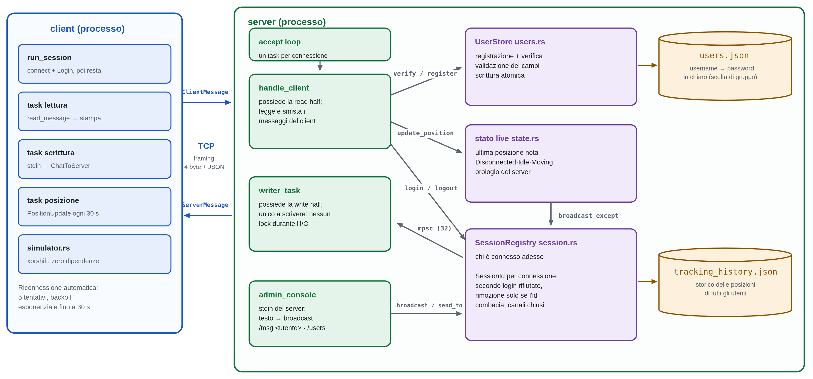
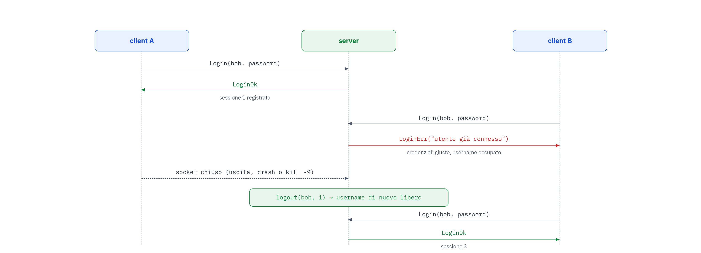
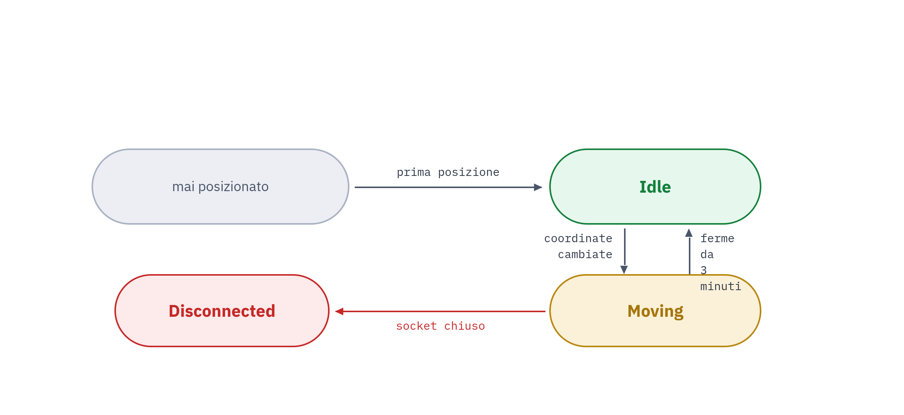
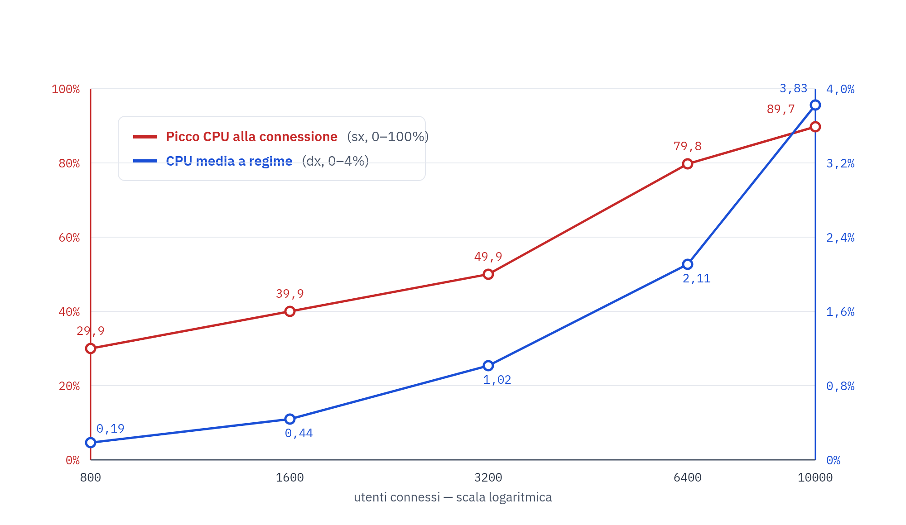

# Georuggine — Manuale del progettista

Sistema di geolocalizzazione per una flotta di veicoli (progetto 2.1). Applicazione
client/server in Rust: più utenti (i **camionisti**) si registrano, si autenticano
e inviano periodicamente la propria posizione emulata al server; l'**amministratore
dell'azienda** controlla i veicoli dalla console del server, interroga lo storico
dei movimenti e scambia messaggi di testo con i camionisti.

Questo documento descrive **come è realizzato il sistema**: architettura, scelte e
loro motivazioni, funzionamento interno dei singoli sottosistemi, requisiti non
funzionali con le misure, qualità e test. Per l'uso dei due programmi si veda
`MANUALE_UTENTE.md`; per una sequenza di prova, `DEMO.md`.

- **Codice:** workpace Cargo in `georuggine/` (`common`, `server`, `client`).
- **Istruzioni operative e variabili d'ambiente:** `MANUALE_UTENTE.md`.

> Riferito allo stato del branch `dev` al commit `2cf344b` (merge `quality-assurance`).

---

## 1. Architettura del sistema

Workspace Cargo con tre crate, così da non duplicare i tipi del protocollo fra
client e server.

| Crate | Responsabilità |
|---|---|
| `common` | Tipi del protocollo (`ClientMessage`, `ServerMessage`) e framing dei messaggi su TCP. Modulo `timing` per i tempi del protocollo. |
| `server` | Ciclo principale asincrono, registro delle sessioni, macchina a stati (solo lato server), storico posizioni persistito e analisi del movimento, console operatore, logging del consumo di CPU. |
| `client` | Binario interattivo: registrazione/login, invio periodico della posizione, chat, riconnessione automatica, simulatore di movimento. |

`server` e `client` dipendono entrambi da `common` via path locale: una modifica al
protocollo si fa in un punto solo.

**Protocollo.** `ClientMessage`: `Register`, `Login`, `PositionUpdate`,
`ChatToServer`. `ServerMessage`: `LoginOk`, `LoginErr`, `RegisterOk`, `RegisterErr`,
`Broadcast`, `Direct`. Serializzazione JSON, framing *length-prefixed* (4 byte
big-endian + payload) con cap a 1 MiB. Lo stato dell'utente
(`Disconnected`/`Idle`/`Moving`) **non** fa parte del protocollo: vive solo lato
server.

**Scelte architetturali principali**

| Ambito | Scelta | Motivazione |
|---|---|---|
| I/O | Asincrono con `tokio`, un task per connessione | Nessun thread OS per client; scala con connessioni prevalentemente inattive. |
| Serializzazione | JSON (`serde_json`), isolata nel modulo `framing` | Leggibile e debuggabile; sostituibile con un formato binario senza toccare client/server. |
| Framing TCP | Length-prefixed (4 byte big-endian + payload), cap a 1 MiB | TCP non ha confini di messaggio; il cap protegge da payload dichiarati enormi. |
| Stato dell'utente | Gestito e mantenuto solo dal server; visibile all'operatore da console, `/users`, `/stats` | La consegna chiede che sia *il sistema* a gestire lo stato, non che gli utenti vedano quello degli altri. Una versione precedente lo trasmetteva in broadcast (`StateChanged`): rimosso, anche per coerenza con la chat non inoltrata fra utenti. |
| Orologio delle transizioni di stato | Orologio del server (trait `Clock` iniettabile), non il timestamp del client | Un client con l'ora sbagliata non deve poter falsare lo stato; abilita test senza attese reali. |
| Comunicazione broadcast/diretta | Decisa dal server tramite console operatore | La consegna descrive solo client→server e server→client. |
| Simulazione della posizione | Generatore pseudo-casuale (xorshift64 scritto a mano) | Nessuna dipendenza `rand`, meno codice nell'eseguibile. |
| Storico posizioni | Persistito su file (`tracking_history.json`), scrittura atomica (temp + `fsync` + `rename`), `load` all'avvio, retention 35 giorni | Le statistiche su settimana/mese richiedono dati che sopravvivono ai riavvii; stesso schema di scrittura di `users.json`. |
| Fuso orario per giorno/settimana/mese | `Europe/Rome`, settimana da lunedì | Scelta esplicita richiesta dall'organizzazione del gruppo; gestisce il cambio di ora legale. |
| Fusi orari incorporati nel binario | Solo `Europe/Rome`, via `filter-by-regex` di `chrono-tz` (`.cargo/config.toml`) | Il database IANA completo (~600 fusi con regole storiche) pesa ~1,7 MB. Il filtro è nel file di config, non in una variabile da esportare a mano: ogni build produce lo stesso eseguibile. |
| Lettura del consumo di CPU | Crate `sysinfo` | Multipiattaforma, senza codice ad hoc per Windows/Linux. |
| Password | In chiaro, nessun hashing | La consegna non pone requisiti di sicurezza e chiede attenzione a dimensione dell'eseguibile e consumo di CPU.

---

## 2. Come è realizzato





### 2.1 `common` — protocollo e framing

I due enum `ClientMessage` / `ServerMessage` sono `#[derive(Serialize, Deserialize)]`
con `serde`. Il modulo `framing` fa da unico punto di contatto con il socket:

- **`send_message`**: serializza il messaggio in JSON, antepone la lunghezza del
  payload su 4 byte big-endian, scrive tutto sul socket asincrono.
- **`read_message`**: legge i 4 byte di lunghezza, verifica che non superi
  `MAX_MESSAGE_SIZE` (1 MiB) — così un mittente ostile o un bug non fanno allocare
  gigabyte — poi legge esattamente quel numero di byte e deserializza.

TCP è un flusso senza confini di messaggio: il prefisso di lunghezza è ciò che
permette a chi legge di sapere dove finisce un messaggio e comincia il successivo.
Isolare qui la serializazione rende sostituibile JSON con un formato binario
senza toccare client o server.

Il modulo `timing` centralizza i tre tempi del protocollo (intervallo di posizione
30 s, soglia di ritorno a `Idle` 180 s, timeout di inattività 90 s). I default
sono quelli della consegna; ciascuno è sovrascrivibile da una variabile d'ambiente
**solo per le prove manuali**, letta una volta sola (`OnceLock`) e annunciata
all'avvio. I test non ne dipendono: usano l'orologio simulato.

### 2.2 Ciclo di vita di una connessione (server)



`main` carica `UserStore` e lo storico (un file corrotto **ferma l'avvio**, non
riparte da vuoto), poi fa il `bind` e per ogni connessione accettata lancia un
task `handle_client`.

Dentro `handle_client`:

1. il socket è diviso in due metà; un `writer_task` dedicato possiede la
   `OwnedWriteHalf` ed è l'**unico** a scrivere sul socket, ricevendo i messaggi
   da spedire da un `mpsc::channel`. Così le scritture non contendono mai un lock.
2. viene allocato subito un `SessionId` univoco, **prima** dell'autenticazione:
   serve comunque alla pulizia finale, perché una connessione può chiudersi senza
   aver mai fatto login.
3. loop di lettura con `timeout(client_idle_timeout(), read_message(...))`:
   - messaggio ricevuto → `match` sul tipo (`Login` / `Register` / `PositionUpdate`
     / `ChatToServer`);
   - errore di lettura → il client si è staccato, si esce dal loop;
   - timeout scaduto → nessun byte per 90 s: la connessione è considerata caduta
     anche se il socket risulta aperto (client congelato, wifi caduto, VM
     sospesa). Senza questo la sessione resterebbe registrata a tempo
     indeterminato: `SO_KEEPALIVE` è spento e il primo sondaggio TCP arriverebbe
     dopo due ore.
4. all'uscita dal loop, la pulizia rimuove la sessione dal registro e libera
   l'username **solo se l'id combacia**, chiude la sessione di tracking e
   aggiorna lo stato a `Disconnected`.

`Login` verifica le credenziali con `UserStore`, poi prova a registrare la sessione
(`clients.login`); se l'username è già connesso la nuova connessione è respinta con
`LoginErr`. Solo dopo un login riuscito apre la sessione di tracking; se
quest'ultima fallisce, il login viene annullato per non lasciare stati incoerenti.
Un secondo `Login` sulla stessa connessione è ignorato.

### 2.3 Registro delle sessioni (`session.rs`)

Mappa `username → (SessionId, Sender<ServerMessage>)` dietro un lock. Punti chiave:

- **login duplicato**: `login` inserisce solo se l'username è libero; altrimenti
  `LoginRejected::AlreadyConnected`. Vince chi è entrato per primo.
- **pulizia sicura per id**: `logout` e la rimozione dei canali chiusi cancellano
  la voce **solo se il `SessionId` combacia**. Una connessione che termina in
  ritardo non può quindi sfrattare la sessione che nel frattempo ha preso quello
  stesso username.
- il lock si tiene solo per il tempo di un lookup o del clone di un `Sender`, mai
  durante la scrittura in rete (che avviene nel `writer_task` del destinatario).
- `broadcast` e `direct_message` iterano i `Sender`, rimuovendo al volo quelli il
  cui `writer_task` è già terminato.

### 2.4 Macchina a stati e orologio iniettabile (`state.rs`)



Struttura in memoria `username → (ultima posizione nota, stato, istante
dell'ultimo cambiamento)`. Transizioni:

| Evento | Transizione |
|---|---|
| prima posizione mai ricevuta | (`Disconnected`) → `Idle` |
| coordinate diverse dall'ultima | → `Moving` |
| coordinate invariate da ≥ 180 s | `Moving` → `Idle` |
| disconnessione | → `Disconnected` |

Il tempo per le transizioni viene da un **trait `Clock`** iniettabile:
`SystemClock` in produzione, un orologio simulato nei test. Questo perché un client
con l'ora sbagliata non deve poter falsare lo stato, e perché così i test sulla
regola dei 3 minuti non aspettano 3 minuti reali. Le coordinate non valide
(`lat`/`lon` fuori range, `NaN`, infinito) vengono scartate e loggate: `update_position`
ritorna `false` e lo stato non viene toccato.

### 2.5 Storico posizioni e analisi (`tracking/`)

Il modulo è **indipendente da TCP**: lavora su `PositionSample` e si prova con
sequenze artificiali.

- **`model`**: `GeoPoint::try_new` (validazione coordinate), `PositionSample`
  (utente, `SessionId`, punto, istante di ricezione lato server, timestamp del
  client a titolo informativo).
- **`repository`** (`FilePositionRepository`): tiene sessioni e campioni in memoria
  e li persiste su file. Registra i campioni solo per una sessione aperta e
  con username coerente; pota i campioni oltre la retention (35 giorni) a ogni
  inserimento. Per non riscrivere il file a ogni campione, la persistenza dopo un
  inserimento è **limitata a una ogni 30 s per utente** (apertura e chiusura
  sessione salvano sempre).
- **`period`**: risolve `day` / `week` / `month` **correnti** in un intervallo UTC,
  sul fuso `Europe/Rome`, settimana da lunedì. Gestisce il cambio di ora legale
  (test sulle transizioni di primavera e autunno). Ammette anche un intervallo
  `custom` con estremi UTC arbitrari.
- **`analytics`**: da una sequenza di campioni ricava i *segmenti* (tratti con dati
  continui, separati da gap troppo lunghi o da cambi di sessione), poi per ciascun
  segmento distingue **movimento** e **pausa** con una soglia di spostamento, e
  aggrega: distanza totale (Haversine), durata del movimento, durata delle pause
  (solo soste a veicolo connesso oltre soglia), velocità media in movimento (esclude
  le pause) e complessiva (le include). Il *tragitto* è la lista dei punti in
  ordine cronologico, senza duplicati consecutivi.
- **`service`** (`SharedTracking`): handle clonabile e thread-safe sopra il
  repository, usato da `handle_client` per registrare le posizioni e dalla console
  per produrre il `MovementReport`.

### 2.6 Console dell'operatore (`console.rs` + `admin_console` in `main.rs`)

`admin_console` legge righe dallo **stdin del processo server**. È l'**unica**
sorgente di `Broadcast` e `Direct`.

- `console.rs` contiene funzioni pure — `parse_console_line` e la formattazione del
  report — così si testano senza uno stdin finto.
- comandi: `/all <testo>`, `/to <utente> <testo>`, `/stats <utente> <periodo>`,
  `/users`, `/help`.
- **il testo libero non è più un broadcast implicito**: prima lo era, e un comando
  scritto male (`/user` invece di `/users`) finiva spedito a tutti i client invece
  di segnalare l'errore. Ora ogni invio è esplicito.
- `format_report` trasforma il `MovementReport` in testo leggibile: distanze in
  m/km, durate come `3h 05m 12s`, velocità in km/h, istanti nel fuso di Roma, e le
  quattro grandezze chieste dalla consegna (tragitto, velocità, durata movimento,
  durata pause), più i punti del tragitto (i primi e gli ultimi se sono molti).

### 2.7 Persistenza: schema di scrittura atomica

`users.json` e `tracking_history.json` usano lo stesso schema, per non lasciare mai
un file a metà:

1. si scrive il contenuto completo in un file temporaneo `*.tmp` nella stessa
   directory;
2. `fsync` sul temporaneo;
3. `rename` atomico sul nome finale.

Un `rename` nelllo stesso filesystem è atomico: un lettore vede il file **vecchio
per intero** o quello **nuovo per intero**, mai una via di mezzo, e un crash a metà
scrittura lascia al più un `.tmp` da ignorare. In lettura, un file presente ma
illeggibile **ferma l'avvio**: ripartire da vuoto, alla prima scrittura,
cancellerebbe i dati esistenti.

Sullo storico, se la scrittura su disco fallisce ma la mutazione in memoria è
andata a buon fine, l'errore (`TrackingError::PersistenceFailed`) viene
**segnalato a chi chiama**, non annullato: il dato resta valido per la sessione
corrente.

### 2.8 Logging del consumo di CPU (`cpu_log.rs`)

Task asincrono che ogni **120 s** scrive su `cpu_usage.log` (aperto in append) una
riga con il tempo di CPU del processo server. Il "sensore" `sysinfo` è creato una
sola volta e tenuto vivo: `cpu_usage()` misura sull'intervallo trascorso
dall'ultimo aggiornamento, quindi ricrearlo a ogni giro darebbe sempre `0.0%`. Il
primo scatto immediato del timer viene saltato.

### 2.9 Il client (`client/`)

Dopo un login riuscito, la sessione interattiva avvia tre task coordinati da un
`writer_task` (unico proprietario della metà di scrittura, come lato server):

- **lettura**: riceve `Broadcast` / `Direct` e li stampa (`[mittente] testo`,
  `[mittente -> te] testo`); alla prima lettura fallita manda un segnale di
  disconnessione su un `oneshot`.
- **stdin**: `select!` fra la riga digitata dall'utente (→ `ChatToServer`, `/quit`
  esce) e il segnale di disconnessione, così il loop non resta bloccato in attesa
  di input quando la connessione cade.
- **posizione**: ogni 30 s chiede al `Simulator` la prossima posizione e la manda
  come `PositionUpdate`.

Il **`Simulator`** è pura logica sincrona, senza rete: a ogni tick, con probabilità
1/2 sposta il punto di ~100 m su ciascun asse, con probabilità 1/2 lo lascia
identico — così si osservano davvero sia `Idle→Moving` sia `Moving→Idle`. Il
generatore è un xorshift64 scritto a mano (seed da username + istante di avvio),
per non aggiungere la dipendenza `rand`.

La **riconnessione automatica** riapre la sessione dopo una caduta *non voluta*
(non un `/quit`, non un login fallito), con backoff esponenziale fino a 5
tentativi.

---

## 3. Requisiti funzionali — stato di copertura

| Requisito della consegna | Dove |
|---|---|
| Registrazione e autenticazione di più utenti | `server/src/users.rs` — `UserStore` persistito su JSON, scrittura atomica, file corrotto che ferma l'avvio. |
| Invio periodico della posizione ogni 30 s | `client` — task dedicato; primo campione dopo un intervallo. Default 30 s (`common/src/timing.rs`). |
| Il sistema gestisce lo stato di ogni utente: `sconnesso` / `fermo` / `in movimento` | `server/src/state.rs` — `Disconnected` / `Idle` / `Moving`, mantenuti dal server; l'operatore li vede da console, `/users`, `/stats`. |
| Transizione fermo → in movimento al cambio di coordinate | `state.rs` — registrata lato server, non trasmessa ai client. |
| Transizione in movimento → fermo dopo ≥ 3 min di coordinate invariate | `state.rs`, soglia 180 s sull'orologio del server. |
| Simulazione del movimento | `client/src/simulator.rs`. |
| Analisi del movimento: tragitto, velocità media, durata del movimento, durata delle pause | `server/src/tracking/analytics.rs` — Haversine, segmentazione movimento/pausa, velocità media escludendo le pause. |
| Intervalli programmabili: giorno / settimana / mese corrente | `server/src/tracking/period.rs` — fuso `Europe/Rome`, più intervallo `custom`. |
| Messaggi del server in broadcast e diretti | Console operatore (`/all`, `/to`). |
| Messaggi di testo dall'utente al server | `ClientMessage::ChatToServer`, non ritrasmesso ad altri utenti. |
| Validazione delle coordinate | `state.rs` / `tracking::model` — coordinate fuori range o non finite scartate. |
| Gestione della disconnessione prima della prima posizione | `state.rs` — nessuna transizione spuria. |
| Rifiuto del secondo login con lo stesso username | `server/src/session.rs` — vince chi è entrato per primo. |
| File di log del consumo di CPU ogni 2 minuti | `server/src/cpu_log.rs` — `cpu_usage.log`. |
| Report con la dimensione dell'eseguibile prodotto | Sezione dedicata di questo documento. |
| Eseguibile su almeno due piattaforme | Windows 11 e Linux x86-64. |

Oltre al minimo richiesto: riconnessione automatica del client con backoff;
timeout di inattività lato server (90 s); storico persistito su file che
sopravvive ai riavvii.

---

## 4. Requisiti non funzionali e prestazioni

### 4.1 Consumo di tempo di CPU

`cpu_log.rs` scrive su `cpu_usage.log` una riga ogni 120 s:

```
[2026-09-04T11:44:00+0200] CPU process usage: 0.04%
```

**Misure.** Server release (build `2cf344b`) + due client che inviano la posizione,
su Windows 11 (x86_64). Campioni ogni 120 s dal task di logging.

| Scenario | Campioni | CPU processo server (min / media / max) |
|---|---|---|
| Server + 2 client, invio posizione ogni 5 s (6× la frequenza di consegna) | 6 | 0.01 % / 0.03 % / 0.04 % |

Serie registrata: `0.04, 0.01, 0.01, 0.04, 0.03, 0.04` %. Nella stessa sessione
`tracking_history.json` è cresciuto fino a ~47 KB.

**Interpretazione.** L'applicazione è I/O-bound ed event-driven: fuori dagli
istanti in cui arriva un messaggio o scatta un timer, ogni task è sospeso. Il costo
per messaggio (serializzazione JSON, Haversine sullo storico, riscrittura di
`tracking_history.json` al più ogni 30 s per utente) è lineare nel numero di
campioni e trascurabile alle frequenze della consegna.

### 4.2 Comportamento sotto carico (molte connessioni simultanee)

Per verificare il comportamento del server con molti utenti, oltre alle misure
sopra (poche connessioni a lungo termine) abbiamo usato uno script Python di
benchmark che
simula un numero elevato di client che si connettono al server, effettuano il
login e poi inviano periodicamente la posizione. Il consumo di CPU del processo
server è stato campionato in due fasi distinte dell'esecuzione:

- **fase di connessione**: molti utenti si connettono e fanno login nello stesso
  breve intervallo di tempo;
- **fase di ricezione dati**: gli utenti, già connessi, inviano solo
  `PositionUpdate` ogni 30 s (nessun calcolo di statistiche, nessun invio di
  messaggi broadcast/diretti).



**Interpretazione.** La fase di connessione è quella effettivamente CPU-intensiva:
ogni login comporta lettura/validazione delle credenziali e inserimento nel
registro delle sessioni, e con molti client che arrivano in un breve intervallo
questi costi si sommano visibilmente sulla CPU del server. È però uno scenario
raro nell'uso reale: avere migliaia di utenti che si collegano tutti nello
stesso istante non è il caso tipico della consegna. Nella fase di ricezione dati,
invece, il consumo di CPU resta notevolmente basso anche con molti utenti
connessi, perché il server si limita a ricevere e persistere le posizioni (nessun
calcolo di statistiche o invio di messaggi in questo scenario), confermando la
natura I/O-bound del sistema anche a un numero di connessioni ben superiore a
quello richiesto dalla consegna.

### 4.3 Dimensione degli eseguibili

Build `cargo build --workspace --release`, senza `strip`, su `2cf344b`. Il filtro
`chrono-tz` sul solo fuso `Europe/Rome` (`.cargo/config.toml`) toglie ~1,7 MB al
server rispetto al database IANA completo (che da solo lo portava a 3,87 MB su
Linux).

| Piattaforma | Eseguibile | Byte | MiB |
|---|---|---:|---:|
| Windows 11 (x86_64-pc-windows-msvc) | `server.exe` | 1 493 504 | 1.42 |
| Windows 11 (x86_64-pc-windows-msvc) | `client.exe` | 884 736 | 0.84 |
| Linux (x86_64-unknown-linux-gnu) | `server` | 2 258 536 | 2.15 |
| Linux (x86_64-unknown-linux-gnu) | `client` | 1 357 592 | 1.29 |

Il divario `server` / `client` è atteso: storico con fusi orari (`chrono-tz`) e
lettura CPU (`sysinfo`) sono compilati solo nel server. Il divario Windows / Linux
dipende da toolchain e linker (MSVC vs GNU). Oltre al filtro sui fusi non sono
applicati `strip`, LTO o `panic = "abort"`.

### 4.4 Portabilità multipiattaforma

Nessun percorso `#[cfg(...)]` specifico per un sistema operativo: rete, filesystem,
tempo e lettura CPU passano per `tokio`, `std` o `sysinfo`.

| Piattaforma | Build release | Test automatici |
|---|---|---|
| Windows 11 (x86_64) | sì | 150 test verdi |
| Linux x86-64 | sì | 150 test verdi |

---

## 5. Qualità: test e controlli automatici

### 5.1 Quality gate

Comandi che ogni modifica deve superare, definiti anche nel workflow
`.github/workflows/ci.yaml`:

1. **Formattazione** — `cargo fmt --check`.
2. **Analisi statica** — `cargo clippy --workspace --all-targets -- -D warnings`.
3. **Test automatici** — `cargo test --workspace -- --test-threads=1` (seriale: i test end-to-end usano porte fisse e lanciano `cargo run`).
4. **Build release** — `cargo build --workspace --release`.

Stato: tutti verdi in locale su Windows 11 e Linux x86-64.

> Il workflow è configurato ma sulle ultime PR **non viene eseguito da GitHub
> Actions per un problema di billing dell'account**. Fino al ripristino, i quattro
> controlli vanno eseguiti a mano prima di ogni merge: gli esiti qui riportati sono
> di esecuzioni locali (identiche sulle due piattaforme).

### 5.2 Suite di test

**150 test, tutti verdi**; `cargo fmt --check` senza differenze; `cargo clippy
-D warnings` senza warning.

| Gruppo | N. | Contenuto |
|---|---:|---|
| `common` (lib) | 9 | Round-trip di framing, cap sulla dimensione del messaggio, override dei tempi da variabile d'ambiente. |
| `server` (lib) | 87 | Macchina a stati (transizioni, validazione coordinate, disconnessione con e senza posizione nota); registro sessioni (login duplicato, pulizia per `SessionId`, canali chiusi, broadcast); storage utenti (registrazione, duplicati, password errata, persistenza al riavvio, file corrotto, scrittura atomica); storico e analisi (Haversine, segmentazione movimento/pausa, periodi `Europe/Rome`, cambio ora legale, persistenza su file). |
| `server` (bin) | 44 | Parsing e formattazione della console operatore, comando `/stats`, logging. |
| `client` (bin) | 4 | Parsing degli argomenti, simulatore. |
| End-to-end (`server/tests/e2e_login.rs`) | 6 | Avviano il server reale e parlano TCP: doppio login rifiutato; disconnessione non notificata agli altri; chat verso utente inesistente che non crasha; posizione non notificata agli altri; messaggio diretto che arriva al destinatario; riconnessione che apre una nuova sessione di tracking. |

Copertura rispetto alla checklist concordata dal gruppo:

| Voce richiesta | Coperta da |
|---|---|
| Registrazione riuscita e duplicata | `users::register_then_verify_succeeds`, `register_duplicate_username_fails` |
| Login corretto e password errata | `users::verify_rejects_wrong_password`, `session::login_su_username_libero_riesce` |
| Doppio login simultaneo | `session::secondo_login_stesso_username_viene_rifiutato`, e2e `e2e_doppio_login_rifiutato` |
| Disconnessione | `state::disconnessione_dopo_posizione_nota_passa_a_disconnected`, e2e `e2e_disconnessione_non_notificata_agli_altri` |
| Broadcast | `session::broadcast_rimuove_i_canali_chiusi_e_consegna_agli_altri` |
| Messaggio diretto | e2e `e2e_messaggio_diretto_valido_arriva_al_destinatario` |
| Destinatario inesistente | `session::invio_a_utente_non_connesso_segnala_not_connected`, e2e `e2e_chat_utente_inesistente_non_crasha` |
| Aggiornamenti della posizione | e2e `e2e_posizione_non_notificata_agli_altri`, `state::cambio_coordinate_passa_a_moving` |
| Transizioni Idle → Moving → Idle | `state::prima_posizione_diventa_idle_ed_e_notificata`, `cambio_coordinate_passa_a_moving`, `coordinate_ferme_tre_minuti_tornano_idle` |
| Interrogazioni per giorno, settimana e mese | test in `tracking/period.rs` e `stats_command_tests` (`server` bin) |
| Riavvio del server e persistenza | `users::utenti_registrati_sopravvivono_al_riavvio`, `repository::sessioni_e_campioni_sopravvivono_al_riavvio`, `una_sessione_chiusa_resta_chiusa_dopo_il_riavvio`, e2e `e2e_reconnect_after_disconnect_opens_new_tracking_session` |

Nessun test attende tre minuti reali: la macchina a stati usa l'orologio simulato
e i test end-to-end parlano il protocollo direttamente.

---

## 6. Decisioni di progetto

- **Gli utenti non vedono lo stato degli altri utenti.** Lo stato è gestito e
  mantenuto dal server ed è visibile all'operatore (console, `/users`, `/stats`).
- **La chat è solo fra client e server, non fra utenti.** Le due entità del
  dominio sono i camionisti e l'amministratore: l'amministratore invia messaggi
  (a uno o a tutti) e i camionisti gli rispondono. Un `ChatToServer` non viene mai
  inoltrato ad altri client.
- **Storico posizioni persistito su file** (`tracking_history.json`), non solo
  in memoria: le statistiche su settimana/mese devono sopravvivere ai riavvii.
- **Lo stato dei veicoli non è persistito** Al riavvio del server non esistono connessioni,
  quindi lo stato corretto di ogni utente è comunque `Disconnected`, e viene
  ricostruito dai `PositionUpdate` non appena i client si riconnettono. Persisterlo
  darebbe uno stato "vecchio" potenzialmente falso.
- **Solo il fuso `Europe/Rome` nel binario** (`filter-by-regex` di `chrono-tz`, in
  `.cargo/config.toml`): −~1,7 MB sull'eseguibile del server.
- **Nessun hashing delle password**: restano in chiaro in memoria e su file. La
  consegna non richiede sicurezza e chiede attenzione a dimensione ed efficienza.
  Nessun TLS.
- **Broadcast/diretto decisi dal server** tramite console operatore.
- **Orologio del server** (trait `Clock`) per le transizioni di stato.
- **`Europe/Rome`, settimana da lunedì** per gli intervalli temporali.
- **JSON** come formato di serializzazione in questa fase.

---

## 7. Limiti noti e lavoro futuro

- **Stato dei veicoli non persistito**: al riavvio riparte da `Disconnected`.
  È corretto per come è definito lo stato, ma va tenuto presente se in futuro
  servisse uno "stato all'ultimo contatto".
- **Errore di scrittura dello storico** (`TrackingError::PersistenceFailed`): la
  mutazione in memoria non viene annullata. Il dato resta valido per la sessione
  corrente, ma un riavvio prima di un salvataggio riuscito lo perde. L'errore è
  sempre segnalato, mai silenzioso.
- **Riduzione della dimensione dell'eseguibile**: applicato solo il filtro sui
  fusi orari; `strip`, LTO e `panic = "abort"` non sono attivi.
- **Analisi accessibile solo dalla console operatore** (`/stats`): nessuna
  interfaccia lato utente.

---

## 8. Analisi e valutazione

### 8.1 Copertura dei requisiti

Tutti i requisiti della consegna sono soddisfatti:

- **Funzionali**: registrazione/autenticazione multi-utente, invio della
  posizione ogni 30 s, gestione dello stato (`sconnesso`/`fermo`/`in movimento`)
  con le transizioni richieste, simulazione del movimento, analisi del movimento
  di un utente (tragitto, velocità media, durata movimento, durata pause) su
  giorno/settimana/mese correnti, messaggistica server→client (broadcast e
  diretta) e client→server.
- **Non funzionali**: file di log del consumo di CPU generato dal programma ogni
  2 minuti, attenzione a consumo di CPU e dimensione dell'eseguibile,
  esecuzione verificata su due piattaforme, dimensione degli
  eseguibili riportata.

L'interpretazione del dominio segue i chiarimenti forniti a lezione: le due
entità sono i **camionisti** e l'**amministratore dell'azienda**; le analisi le fa
l'amministratore, tramite un'applicazione lato server che interroga lo storico
(la console, comando `/stats`); i messaggi del server sono testo scritto da un
umano, verso un singolo utente o in broadcast.

### 8.2 Punti di forza

- **Separazione dei concern**: tre crate, e all'interno del server moduli
  (`state`, `session`, `tracking`, `console`) provabili in isolamento. La logica
  di analisi non conosce TCP; il parsing/formattazione della console sono funzioni
  pure.
- **Robustezza sui casi limite reali**: timeout di inattività per il client che
  sparisce senza chiudere il socket; scrittura atomica di utenti e storico; un
  file dati corrotto ferma l'avvio invece di sovrascrivere; la pulizia della
  sessione avviene solo se l'id combacia, così una connessione che termina in
  ritardo non sfratta chi ha preso quell'username.
- **Testabilità**: orologio iniettabile e analisi indipendente dalla rete
  permettono 150 test — inclusa la regola dei 3 minuti e le transizioni di ora
  legale — senza attese reali e con esito identico su Windows e Linux.
- **Efficienza**: architettura event-driven, consumo di CPU del server sotto il
  decimo di punto percentuale anche a 6× la frequenza di campionamento richiesta;
  eseguibili ridotti incorporando nel binario il solo fuso `Europe/Rome`.

### 8.3 Compromessi e loro giustificazione

| Scelta | Costo accettato | Perché |
|---|---|---|
| Serializzazione JSON invece che binaria | Qualche byte in più per messaggio e parsing meno rapido | Leggibilità e debug; isolata in `framing`, sostituibile senza toccare client/server |
| Password in chiaro, nessun TLS | Nessuna riservatezza delle credenziali | La consegna non pone requisiti di sicurezza e premia dimensione e consumo di CPU, che l'hashing e il TLS peggiorerebbero |
| Analisi e messaggi solo dalla console del server | Nessuna interfaccia grafica o lato utente | Modello "l'amministratore controlla i camionisti"; la consegna descrive la comunicazione solo come server↔client |
| Stato non persistito | Nessuno "stato all'ultimo contatto" dopo un riavvio | Al riavvio non ci sono connessioni: lo stato corretto è `Disconnected`, ricostruito dai `PositionUpdate` |
| Storico in un file JSON, non un DB | Query lineari, nessun indice | Volumi piccoli (decine di KB), retention di 35 giorni, nessuna dipendenza aggiuntiva nel binario |

### 8.4 Possibili sviluppi

Sintesi dei limiti noti: `strip`/LTO/`panic = "abort"` per ridurre ancora i
binari; console utilizzabile senza un operatore collegato allo `stdin`; intervallo
del log CPU configurabile come gli altri tempi; passaggio a un formato di
serializzazione binario se il traffico crescesse; eventuale interfaccia dedicata
per l'amministratore al posto della console testuale.

### 8.5 Conclusione

Il progetto realizza un sistema distribuito client/server in Rust che copre gli
obiettivi funzionali della consegna e ne rispetta gli obiettivi non funzionali
espliciti — efficienza, dimensione dell'applicativo, multipiattaforma, log del
consumo di CPU. Le scelte non ovvie sono documentate con la loro motivazione e
verificate da una suite di test che gira identica sulle due piattaforme.

---

## 9. Tabella riepilogativa dei risultati

| Voce | Risultato |
|---|---|
| Requisiti funzionali della consegna | Tutti implementati |
| Test automatici | 150 / 150 verdi (identico su Windows e Linux) |
| Formattazione (`cargo fmt --check`) | Nessuna differenza |
| Analisi statica (`cargo clippy -D warnings`) | Nessun warning |
| Build release | OK su Windows e Linux |
| Piattaforme verificate | Windows 11 + Linux x86-64: build + test + esecuzione |
| Dimensione `server` (release) | Windows 1 493 504 B (1.42 MiB) · Linux 2 258 536 B (2.15 MiB) |
| Dimensione `client` (release) | Windows 884 736 B (0.84 MiB) · Linux 1 357 592 B (1.29 MiB) |
| Log CPU | `cpu_usage.log`, una riga ogni 120 s; consumo del processo server media 0.03 %, max 0.04 % |
| Controlli automatici | Workflow `.github/workflows/ci.yaml`; su GitHub Actions sospeso per billing, eseguiti in locale su Windows e Linux |

---

## 10. Come si esegue (sintesi)

Dettaglio, vincoli sulle credenziali e variabili d'ambiente: `MANUALE_UTENTE.md`.
Sequenza di dimostrazione: `DEMO.md`.

```bash
# dalla cartella georuggine/

# server (default 0.0.0.0:8080, users.json, tracking_history.json)
cargo run -p server --release

# client
cargo run -p client --release -- register alice password-alice
cargo run -p client --release -- login alice password-alice

# console del server: /all <testo> | /to <utente> <testo> | /stats <utente> <day|week|month|custom start end> | /users | /help

# controlli
cargo fmt --check
cargo clippy --workspace --all-targets -- -D warnings
cargo test --workspace -- --test-threads=1
cargo build --workspace --release
```

Il server crea nella working directory `users.json`, `tracking_history.json` e
`cpu_usage.log` (tutti ignorati da git). `.cargo/config.toml` impone
`CHRONO_TZ_TIMEZONE_FILTER=Europe/Rome` per ogni build.
